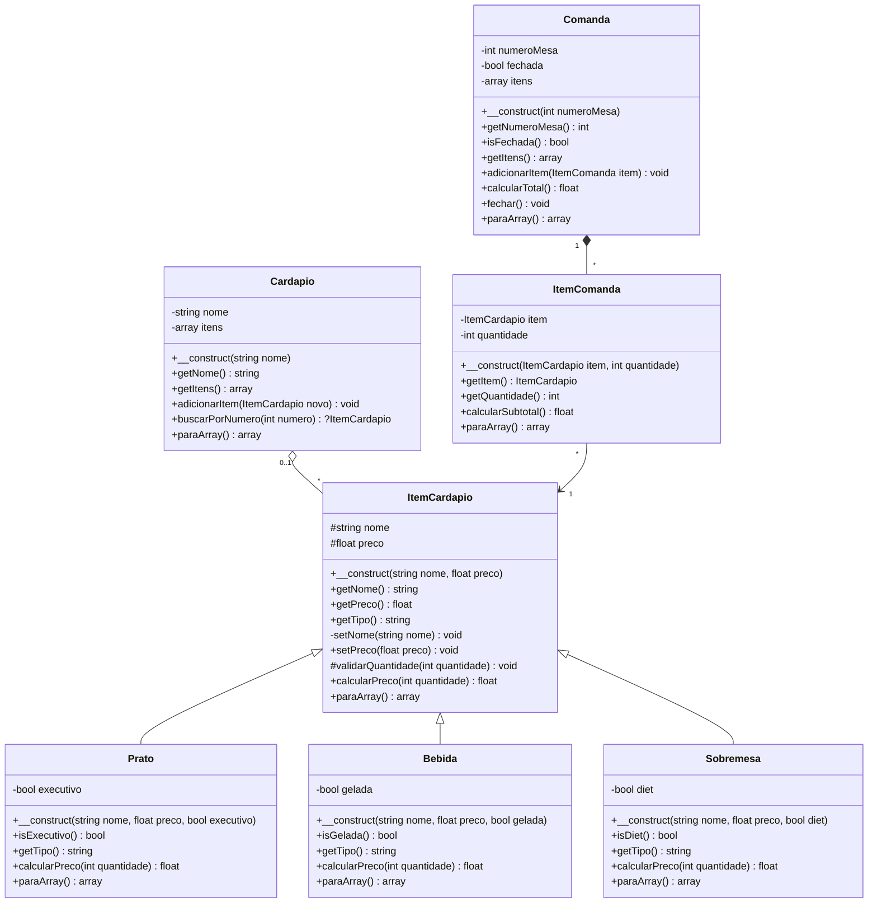

# Modelagem

## Diagrama de classes

`<|--` é herança (é um); `*--` é composição (tem um, e a parte não existe sem o todo); `o--` é agregação (reúne, mas as partes existem sozinhas); `-->` é associação (usa uma referência). `#` é protected, `-` é private e `+` é public. `?ItemCardapio` é o tipo anulável do PHP: o método pode devolver `null`.

## Justificativas (Bem detalhadas até)

### Herança: ItemCardapio → Prato, Bebida, Sobremesa
- Um prato **é um** item do cardápio, uma bebida **é um** item do cardápio e uma sobremesa **é um** item do cardápio. Os três têm nome e preço, então esses atributos ficam na classe mãe.
- `calcularPreco()` é o método sobrescrito nas subclasses: cada filha mantém a assinatura da mãe e muda só o cálculo (o prato executivo soma o acompanhamento, a bebida gelada soma a taxa e a sobremesa dá desconto a partir de 3 unidades). `getTipo()` e `paraArray()` também são override (desculpa, é mais bnt em inglês--).
- Cada filha chama `parent::__construct()` para reaproveitar a validação do nome e do preço.
- Polimorfismo: quem usa um item (a linha da comanda, a página do cardápio) chama `calcularPreco()` sem precisar verificar manualmente se ele é prato, bebida ou sobremesa, e não precisa mudar quando surgir um tipo novo.

### Composição: Comanda tem ItemComanda
- Uma comanda **tem** linhas de pedido, e `ItemComanda` não tem significado independente no domínio do sistema: "2 sucos de caju" só existe como parte de uma comanda e deixa de existir com ela. Por isso é composição (`*--`).
- A classe `ItemComanda` existe porque a **quantidade** pertence ao pedido, não ao item do cardápio: o mesmo suco pode aparecer em várias comandas com quantidades diferentes.
- `Comanda` tem `adicionarItem()` e `calcularTotal()`, que soma o subtotal de cada linha. A multiplicidade `"1"` para `"*"` indica que uma comanda tem várias linhas e cada linha pertence a uma só comanda.

### Agregação: Cardapio reúne ItemCardapio
- O cardápio **reúne** itens, mas um item pode existir sem estar em um cardápio: ele é criado antes e só depois adicionado (e pode até ser recusado, por nome repetido, e continuar existindo como objeto). Por isso é agregação (`o--`), e não composição.
- A multiplicidade `"0..1"` do lado do `Cardapio` indica que cada item pertence a no máximo um cardápio (o sistema tem um único cardápio) ou a nenhum, e o `"*"` do outro lado indica que o cardápio reúne vários itens.
- O cardápio garante que não haja dois itens com o mesmo nome e busca um item pelo **número** dele no cardápio (`buscarPorNumero`), que é a posição do item na lista, começando em 1. Os itens não têm um atributo `id` próprio. O método devolve `?ItemCardapio`, ou seja, `null` quando o número não existe, e a página usa isso para responder 404.

### Associação: ItemComanda → ItemCardapio
- A linha da comanda mantém uma **referência** a um item do cardápio, sem controlar o ciclo de vida dele: o item continua existindo no cardápio mesmo que a comanda deixe de existir. Por isso é uma seta simples (`-->`), não uma composição.
- A multiplicidade `"*"` para `"1"` indica que várias linhas podem apontar para o mesmo item.

### Outras decisões
- Os atributos são `private` ou `protected`, nunca `public`. `nome` e `preco` são `protected` na classe mãe, como no diagrama, para que as filhas possam acessá-los se precisarem. Hoje as filhas não leem esses atributos: reaproveitam o cálculo da mãe. Por isso eles poderiam ser `private`, com getters, sem mudar o comportamento.
- Só `setPreco()` é público, porque o preço de um item pode mudar. O nome só é definido no construtor.
- Não usei classes abstratas nem interfaces, porque não são obrigatórias para este trabalho.
